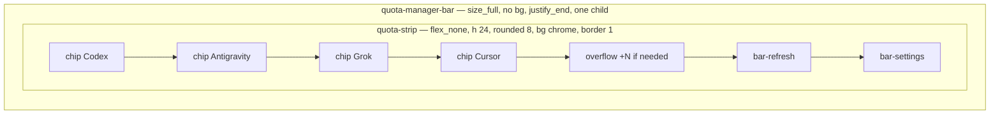
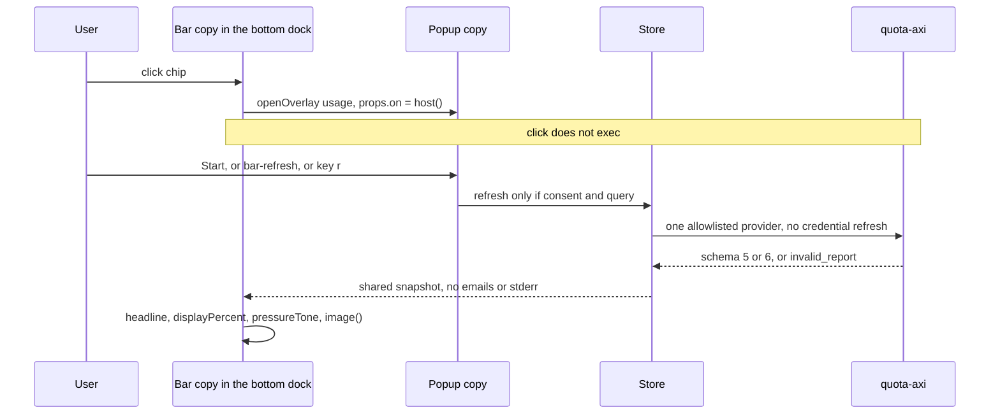

# Bottom-right quota strip

| | |
| --- | --- |
| Author | _unassigned_ |
| Date | 2026-11-12 |
| Status | Draft |
| Repository | `herdr-quota-manager` |
| Scope | GPUI mod `mods/quota-manager/`. Not a React app, not a Herdr TUI plugin, not a Node service. |

## Overview

The live Herdr window on layout `main-quota` paints the quota mod twice: a hand-inserted block above `workspace-status`, and the block Herdr docked because `mod.json` says `"place": "bottom"`. Both copies render the same left-aligned toolbar (`Settings`, `Codex — !`, `Antigravity — !`, `Grok — !`, `Cursor — !`).

This design keeps exactly one dock, the Herdr bottom slot, and changes only what that slot paints: one 24px rounded line packed to the trailing edge, in the same reading order as the Over9k footer (identity, plan, percent, reset) without copying Over9k chrome or provider trademarks. Provider identity stays the existing two-letter monogram: text in the 14px slot in the first change, then the same letters on a colored tile drawn with `image()` in the second. The printed percent is unchanged (`displayPercent`: remaining unless the user selected Used). Color follows how full the same window is, using theme tokens `ansi2` / `ansi3` / `ansi1` at 50% and 80% used. `stripFace` is the only procedure that picks those colors.

No collector command, schema check, consent gate, installer layout policy, or `shared.json` key changes.

## Background & Motivation

### What the screenshots show

Image #1 is the running window. `herdr-app status` last reported layout `main-quota`. The red box sits in the work column, directly above the status line `This computer · main · 3 agents`. An identical row is painted again under that status line, at the bottom edge of the window. Both rows are the current bar from `QuotaManager.render` (`mods/quota-manager/main.js` lines 111–122): a full-bleed `t.chrome` strip, `border_t`, a leading `open` button, text chips, a spacer, then `↻` and `⚙`.

Image #2 is the reference, not a spec to clone. Over9k draws one compact rounded line: `Claude`, a small plan pill, a percent, a reset (`3h 12m`). Copy on that image: green, yellow from 50% used, red from 80% used; click a row for every limit as bars; “one line along the bottom of the window.” Plan pills and percent color carry the warning. It is not a settings toolbar.

### Why two blocks exist

`C:\Users\lyh\.config\herdr-app\layouts\main-quota.json` is a personal clone (`cloned_from` shipped `main` version 0.1.15). Its outer node is column `r9e696357aa1b6319f4b71252502fcedb`. Two children mount `content.mod = quota-manager`:

1. Inside column `work`, between row `work-body` and block `status` (`workspace-status`, px 28): block id `quota-manager`, size px 30. This is the red-boxed row. It was inserted by hand. It is not created by `scripts/install.mjs`.
2. Sibling of row `root`, at the bottom of the outer column: block id `b8aab61ac55b114d2a384835d2b0157db`, size px 30. This is Herdr’s one-time auto-dock. Herdr’s app guide says the first time a mod folder is seen, Herdr docks one copy from `mod.json` into the shown layout. `mods/quota-manager/mod.json` is `{ "place": "bottom", "size": 30, "focusable": true, "overlay": { "width": 540, "height": 620 } }`. After that first dock, layouts decide. Saving the mod reloads every copy already in the tree; it does not remove a second copy.

Shipped `main`, `terminals`, and `win98` are replaced on start. `layout.set` on a shipped layout changes click and look only. `layout.clone` is what switches to a clone. The installer copies the mod directory and does not rewrite layouts, keys, or `shared.json` (`scripts/install.mjs` success text, and `.trellis/spec/tooling/installer.md`).

Each mounted copy is its own `QuotaManager`. Both run `cx.timer.every(10000)` and `cx.timer.every(30000)`. Hiding a block does not stop that: Herdr keeps a copy alive while its block remains in the tree, shown or not. The extra block has to be removed, not hidden.

### Why the current chips do not match the reference

`chip()` (`ui.js` lines 80–88) builds one string: glyph or name, headline percent or `—`, and ` !` whenever `laneStatus()` is non-empty. `button()` (lines 7–14) paints that string on `t.raised` or `t.selected`. With the default config, `consent` is false while `show` and `query` default on for `codex`, `agy`, `grok`, and `cursor` (`config.js` lines 4–16 and 21). `laneStatus()` returns `paused` before it looks at a lane, so every chip is `Name — !` and the leading button says Settings. That is the screenshot. No subprocess has run. The em dash is intentional; there is no tilde in `ui.js`.

`tone()` (line 27) colors meters and compact cards from **remaining**: `ansi1` at or below 10, `ansi3` at or below 25, otherwise `ansi2`. Alerts in `store.js` use the separate preference `threshold` (0, 5, 10, or 20) against `w.remaining`. Those contracts stay. The strip needs a different scale because the reference is usage pressure at 50 and 80, and the number on screen is not always a used-percent.

Provider identity is `p.glyph` from `providers.js` (`CX`, `AG`, `GK`, `CU`, …), a two-letter monogram. `THIRD_PARTY_NOTICES.md` states that badges are plain text monograms, not copied logos, and that this repo does not bundle brand artwork.

## Goals & Non-Goals

### Goals

- One quota strip on the current `main-quota` window, at the bottom-right of the window.
- The installer still does not write layouts. `place: "bottom"` is the only automatic slot, and it docks once into the layout that is shown the first time Herdr sees the folder. That dock lasts only on a personal layout. A first sight while shipped `main`, `terminals`, or `win98` is shown writes the only automatic dock into a file the next start replaces, and Herdr does not dock again. A durable strip is one block on a personal layout. A second block still polls if it is only hidden.
- The dock’s painted control is one horizontal rounded line: icon, name, optional plan pill, percent, optional countdown, packed to the trailing edge.
- Colorful provider icons for every id in `providers.js`, using a GPUI API that exists in `gpui-kit.d.ts`, with files inside the mod, no network fetch at render.
- Percent color that matches Over9k’s 50% / 80% used thresholds without changing what the digits mean.
- Empty, loading, error, consent-off, query-off, and show-off states that reuse `i18n.js` keys except one new short empty label.
- Existing chip click opens the usage overlay. Settings and manual refresh stay reachable. Overlay size stays 540×620.

### Non-goals

- Changing `command.js`, `fetchQuota`, `--json --provider <id> --no-credential-refresh`, schema 5/6 acceptance, or exit-code handling.
- Changing consent, Muse consent, query versus show, leases, cache keys, or history.
- Editing `shared.json`, shipped layouts, keybindings, or injecting layout JSON from `scripts/install.mjs`.
- A second collector, account login, credential refresh, inference opt-in, cookie import, arbitrary profiles, drag-and-drop order, or billing charts.
- Redesigning the usage, settings, history, or help overlay. The card header may swap its monogram for the same icon; meters, tabs, and copy stay.
- Copying Over9k layout chrome, or copying SVG path data from Herdr `icons/`, LobeHub, or Simple Icons.
- A preference that toggles the old toolbar back on.
- Pixel certification in `tests/ui.test.mjs`. Live proof remains `docs/VALIDATION.md` and `herdr-app shot`.

## Proposed Design

### Placement

Keep `mod.json` exactly as it is: `"place": "bottom"`, `"size": 30`. The product’s only durable slot is the auto-dock. On this machine that slot is block `b8aab61ac55b114d2a384835d2b0157db`.

Remove only the hand-inserted block whose id is `quota-manager`, the child of column `work` between `work-body` and `status`. That is the red box. Do not remove `b8aab61ac55b114d2a384835d2b0157db`. Do not edit `layouts/main.json`, `layouts/terminals.json`, or `layouts/win98.json`. Do not `layout.hide` the extra block: a hidden copy still polls.

```mermaid
flowchart TB
  subgraph outer["column r9e696357aa1b6319f4b71252502fcedb"]
    subgraph root["row root — clone of shipped main 0.1.15"]
      sidebar["column sidebar"]
      subgraph work["column work"]
        tabs["block tabs"]
        body["row work-body"]
        dup["block id quota-manager px 30 — REMOVE"]
        status["block status / workspace-status px 28"]
      end
    end
    dock["block b8aab61ac55b114d2a384835d2b0157db px 30 — KEEP and restyle"]
  end
  outer --> root
  outer --> dock
  work --> tabs
  work --> body
  work --> dup
  work --> status
```

The mod cannot collapse the duplicate itself. `props()` on both blocks is empty, `placement()` is null unless the block floats, and nothing in `herdr.d.ts` tells a copy which layout id mounted it. Two `View` instances would both return the same nodes. One of them has to leave the tree.

A fresh install does not insert a block by itself. Herdr docks one bottom copy the first time it sees the folder, into the shown layout only, and it will not dock a second time if that block is later deleted or the file is replaced. Two current docs tell the reader to add another block anyway: `README.md` lines 46–57 (the sentence “A personal layout can place it explicitly”, the copy-paste block whose id is `quota-manager`, and line 57: “Do not overwrite a user's complete layout to add this block”) and `RECIPE.md` line 14 (“add a block whose content is `{ "mod": "quota-manager" }`”). Doing that on a layout that already received the bottom dock is this bug. Replacing only lines 46–55 leaves line 57, which still says to add a block after the JSON antecedent is gone. `README.zh-CN.md` line 45 does not tell the reader to insert a block; it is not in the file list. PR 1 rewrites README lines 46–57 and the recipe line so they stop prescribing a block. Do not add installer logic that scans layouts: that is an automatic layout edit, forbidden by the installer spec.

Switching to shipped `main` shows no strip after the next start even if the mod was first seen there. Herdr replaces `main`, `terminals`, and `win98` on every start, and it does not dock again into the restored file. Do not “fix” that by writing `main.json`. A personal layout that has no quota block stays without one until its owner adds a single block, and only when the layout does not already contain one. Hiding the extra block is not removal: Herdr keeps the copy’s timers while the node remains in the tree.

### What the 30px slot paints

The layout slot stays 30 logical px and full window width. The mod does not get a content-sized dock. Inside the slot, the painted control is a 24px pill at the trailing edge. The leading remainder is an empty flex region: no background, no `border_t`, no click handler. A full-bleed chrome bar is what makes the current dock look like a second settings toolbar.



There is no `flex_1` spacer child. The unused leading area is the row’s free space. `quota-strip` is `flex_none()`, so it stays content-sized and `justify_end` pins it to the trailing edge. A growing pill would paint full-bleed chrome again, which is the toolbar in alternative 2. Do not put `flex_1()` on the pill. The pill is built in `ui.js` (`quotaStrip`). `main.js` does not call `h_flex`; `.trellis/spec/mod/runtime-boundary.md` allows `h_flex` only in `ui.js`. `main.js` keeps the outer `row()` because that node owns `track_focus`, `on_key_down`, and `on_size_change`.

Approximate look, default four providers, consent off, wide window:

```text
|                                                    [ (codex) Codex —   (agy) Antigravity —   (grok) Grok —   (cursor) Cursor —   ↻  ⚙ ] |
```

With a live headline, remaining mode, same window whose used-percent is 36 (remaining 64), reset in 3h 12m, plan text `Plus`:

```text
[ (icon) Codex  Plus  64%  3h 12m ]
```

`64%` is remaining. It is green because used is 36, which is under 50. See Color scale. The digits are not the Over9k digits.

Normative geometry, logical px at zoom 1 (Herdr scales layout px and mod text with `settings.zoom`):

| Piece | Rule |
| --- | --- |
| Outer row | id `quota-manager-bar`. `size_full()`, `px(6)`, `items_center()`, `justify_end()`. No `bg`, no `border_t`. Keeps `track_focus`, `on_key_down`, `on_size_change`. |
| Pill | id `quota-strip`, returned by `quotaStrip` in `ui.js`. `flex_none()`, `h(24)`, `px(8)`, `gap(10)`, `items_center()`, `rounded(8)`, `bg(t.chrome)`, `border(1)`, `border_color(t.border)`, `overflow_hidden()`. |
| Chip | Flat hit target, not `button()`’s raised chrome. `px(4)`, `gap(4)`, `items_center()`, `flex_none()`, `rounded(4)`, hover `t.hover`. |
| Mark slot | Always 14×14 `flex_none()`. PR 1 is `div().w(14).h(14).overflow_hidden().items_center().justify_center().text_size(8)` whose child is `p.glyph`, beside the name, not instead of it. The name estimate is 8px per character at `text_size(11)`, so two letters at size 11 are about 16px and would ignore the 14px budget (`min-width: auto`). Size 8 scales that estimate to about 12px, inside the box; `overflow_hidden` clips a wider font. PR 2 replaces the box’s child with `image().w(14).h(14)` and does not also paint the glyph. `stripBudget` counts 14px for this slot in both PRs. |
| Name | `text_size(11)`, `text_color(t.foreground)`, `whitespace_nowrap()`. Always shown. |
| Plan | Only if `lane.plan` is non-empty. `text_size(10)`, `px(4)`, `rounded(4)`, `bg(t.selected)`, `text_color(t.muted)`, `max_w(64)`, `truncate()`. |
| Percent | `text_size(11)`, `font_semibold()`, `whitespace_nowrap()`. Color from the scale below. |
| Countdown | `text_size(10)`, `text_color(t.dim)`. Existing `countdown()` string. No clock glyph. |
| Refresh and settings | Ids stay `bar-refresh` and `bar-settings`. Both PRs set `accessibility_label` and `tooltip` to `tr(cfg, "refresh")` and `tr(cfg, "settings")` (`main.js` lines 121–122 already set those tooltips). The control is 13×13, `px(0)`, `overflow_hidden`, so the fitter’s `chrome` term stays 13 + gap + 13. PR 1’s child is the text glyph `↻` or `⚙` at `text_size(11)` and `text_color(t.muted)`. PR 2 replaces that child with `svg(...).size(13).text_color(t.muted)`. PR 1 does not call `svg()` or `.size()`. |

`t.chrome` is `#11111b` in the layout’s dark theme `catppuccin-mocha` and `#dce0e8` in light `catppuccin-latte` (`themes/catppuccin-mocha.json`, `themes/catppuccin-latte.json`). The same tokens follow any other theme. Do not hard-code those hex values in JavaScript. `.trellis/spec/mod/ui.md` already forbids a hard-coded node palette.

`overflow_hidden` on the pill is a backstop so a font-metric miss cannot wrap a second line into a 30px slot. It is not how providers disappear.

### Overflow

Drop fields in this order, for every chip together, then drop whole chips. Do not shrink type below 11 / 10. Do not `overflow_x_scroll` a 30px bar. Do not drop the provider name. Do not reverse order: the first `items()` entry stays the leftmost chip in the pill; settings stays the rightmost node. That puts the group in the bottom-right corner and keeps catalog order readable.

| Tier | Painted | When |
| --- | --- | --- |
| 0 | icon, name, plan if any, percent, countdown if the headline has `resetsAt` | The group fits. |
| 1 | Countdown omitted | Tier 0 wider than the slot. |
| 2 | Plan omitted as well | Tier 1 still wider. |
| then | `items.slice(0, capacity)` plus id `overflow` labeled `+N` | Tier 2 still wider. Extra chips open the usage overlay, as today. |

`main.js` already owns `this.width`, initialized to 800 and corrected in `on_size_change` when the delta exceeds 1px. Keep that. Put the estimator next to the chip so the fields cannot drift:

```javascript
// ui.js — estimates logical px. Overestimates Latin text so the pill drops
// a field before overflow_hidden clips a glyph. Not a measurement API.
// The 14 is the mark slot (glyph in PR 1, image in PR 2). The name is added
// for every tier the fitter actually passes (0, 1, 2). Do not pass 3.
export function stripBudget(item, cfg, now, tier) {
  const name = provider(item.id).name.length * 8;
  const head = item.lane && headline(item.lane, cfg, now);
  let width = 8 + 14 + 4 + 36; // pad, mark slot, gap, percent
  if (tier < 3) width += name + 4;
  if (tier < 2 && item.lane?.plan) width += Math.min(64, 12 + [...item.lane.plan].length * 8) + 4;
  if (tier < 1 && head?.resetsAt) width += 56 + 4;
  return width;
}
```

The fitter lives in `ui.js` next to `stripBudget` and is called only from `quotaStrip`. It never passes tier 3, so the name is always painted and always counted. `tier < 3` is not a fourth overflow step.

```javascript
function fitStrip(items, width, cfg, now) {
  const gap = 10;
  const shell = 12 + 16;           // row px(6)*2 + pill px(8)*2
  const chrome = 13 + gap + 13;     // refresh, the gap before settings, settings
  const overflowW = 36;
  const base = shell + chrome;      // 64, used when every chip fits
  const chipsWidth = (tier, list) => list.reduce((sum, item) => sum + stripBudget(item, cfg, now, tier), 0);
  // gap * list.length is one trailing gap per chip, including the gap before refresh.
  const fitted = (tier, list) => base + chipsWidth(tier, list) + gap * list.length;
  for (let tier = 0; tier <= 2; tier++) {
    if (fitted(tier, items) <= width) return { tier, capacity: items.length };
  }
  let capacity = 0;
  for (let n = 1; n <= items.length; n++) {
    const list = items.slice(0, n);
    // (n - 1) gaps between chips, plus chip-to-+N, plus +N-to-refresh.
    const used = shell + chipsWidth(2, list) + gap * (n + 1) + overflowW + chrome;
    if (used > width) break;
    capacity = n;
  }
  return { tier: 2, capacity };
}
```

There is no hidden slop term. The gap before `+N` is `gap * (n + 1)`, not something buried in `reserve`.

Checked against `tests/ui.test.mjs` “compact bar exposes overflow”, which sets `width` to 220 and clicks id `overflow`. Default `items()` with `showUnavailable: true` yields four lanes with no plan and no countdown (`codex`, `agy`, `grok`, `cursor`). Tier-2 budgets are 106, 154, 98, and 114 (8 + 14 + 4 + 36 + name×8 + 4). The tier loop fails. The capacity loop’s first attempt is `n = 1`: shell 28 + 106 + gap×2 (20) + overflow 36 + chrome 36 = 226, and `226 > 220`, so `capacity` stays 0. `overflow` still renders and id `open` does not, because `items.length` is 4. That matches today’s `floor((220 - 180) / 78) = 0`. Do not shrink the shell, chrome, or the 14px mark slot until that test is updated on purpose.

At width 800 those four chips, with no plan and no countdown, take `64 + 472 + 40 = 576` and fit at tier 0. A capped plan adds `64 + 4` and a countdown adds `56 + 4`, which is 128 per chip, not 120. Four chips that each have both take `576 + 512 = 1088`. Tier 0 needs width ≥ 1088. At 800 the fitter rejects tier 0 (`1088`) and tier 1 (`1088 - 240 = 848`) and selects tier 2 (`848 - 272 = 576`). The dock is the full window width, not the editor column. A window wider than 1088 keeps countdown and plan for the default four; an 800px window does not.

`items()` order is unchanged: show-filtered, then `sort === "remaining"` by headline remaining with missing headlines last (`101`). The strip does not sort a second time.

### Chip contents and the number

One chip per `items()` entry. One lane per chip. `multiple` accounts do not print `lane.key` on the strip; the tooltip keeps the existing last-4 suffix. The headline stays `headline()`: the trusted, non-share window with the lowest `remaining`, whose reset is still in the future. The countdown is that window’s `resetsAt`, not the soonest reset of a different window, and not a sum across windows or providers.

| Slot | Source | Empty value |
| --- | --- | --- |
| Icon | PR 1: `provider(id).glyph` inside `w(14).h(14).overflow_hidden()` at `text_size(8)`, beside the name. PR 2: `image("mods/quota-manager/icons/<id>.svg")` in that same slot, and not the glyph as well. | Name text is always present. In PR 2 a missing image leaves the 14px gap; do not paint a second monogram beside it. |
| Name | `provider(id).name` | Never omitted. |
| Plan | `lane.plan` after `safeText` (already ≤ 80 chars) | Pill omitted when the string is empty. |
| Percent | `typeof shown === "number" ? Math.round(shown) + "%" : "—"` where `shown` is `displayPercent` of the headline, or null when there is no headline | Em dash `—` (U+2014). `Math.round(null)` is `0` in JavaScript, so a missing null check would paint `0%`, which is forbidden. Not `~`. |
| Time | `countdown(head.resetsAt, now)` | Omitted when there is no headline or no `resetsAt`. Tier 1 omits it even when present. |

`displayPercent` (`model.js` lines 93–96): null when the window is untrusted or the reset has passed; otherwise `used` for a `shareOf` window or when `config.percentage === "used"`; otherwise `remaining`. Default `percentage` is `"remaining"` (`config.js` line 26). `validWindow` drops share windows, null remaining, untrusted windows, and passed resets, so `headline()` never hands the strip a share window or an expired window. A share-only lane paints `—`. A passed reset does not refill the number. Do not add a percent of percents.

Tooltip and `accessibility_label` use the existing vocabulary, but the status key comes from `stripFace` below, not from `laneStatus()`. `laneStatus()` (`ui.js` lines 41–46) returns `paused` before it looks at `snapshot.error`, `item.busy`, or `lane.status`, so it cannot implement the ordered color steps. The visible ` !` suffix is removed. Shape, otherwise unchanged from `chip()` lines 87–88: provider name, optional account suffix, headline label, value, `tr(cfg, cfg.percentage)` (`Remaining` / `剩余` or `Used` / `已用`), `tr(cfg, key)`, and the countdown when a headline exists. `accessibility_label` is that string with newlines replaced by `", "`.

`button()` stays the raised control used by settings, tabs, and toggles. The strip does not go through it, because `bg(t.raised)` and `px(8).py(5)` are the toolbar look being removed, and `py(5)` plus default type clips “Choose providers” inside a 24px pill. `flatButton` copies the interaction contract: `role("button")`, `accessibility_label`, `tooltip` set to that same string, `on_mouse_down` and `on_click` both `stop_propagation`, hover background, stable id. Text controls (`open`, `overflow`) are `text_size(11)`, `px(4)`, and no `py`. Do not add `chip()`’s later `.py(2)` either; `items_center` on the 24px pill is the vertical placement. Chrome controls use the same helper with a 13px box and `px(0)`, defined with the `quotaStrip` snippet. Chip tooltips still use the `stripFace` sentence, with newlines replaced by `", "` on `accessibility_label`.

Stable ids that tests and the UI spec already depend on:

| Id | Still |
| --- | --- |
| `chip-<provider>-<laneKey>` | Yes. Empty lane suffix stays `empty`. |
| `overflow` | Yes, only when `capacity < items.length`. |
| `bar-refresh` | Yes. `poll(cx, true)`. |
| `bar-settings` | Yes. `open("settings")`. |
| `open` | Only when `items.length === 0`. Not when `fit.capacity === 0` while items still exist. Label is the new short string. Action `open("settings")`. |
| `quota-manager-bar` | Yes, outer row. |

Chip click remains `open("usage")`, including when the chip shows an error or an em dash. The overlay already renders `laneStatus`, meters, and consent copy. Chip click does not depend on the bar being full width.

Keyboard on the bar is unchanged: `u` / `enter` usage, `s` settings, `r` refresh, `h` history, `escape` moves focus up via `pane.go`. Lifecycle, `cx.timer`, `cx.spawn`, and host calls stay in `main.js`. `ui.js` returns nodes.

### Color scale

Two functions. Do not merge them.

`tone(w, t)` stays. `meter()` and the compact percent in `providerCard()` keep remaining ≤ 10 as `t.ansi1`, ≤ 25 as `t.ansi3`, else `t.ansi2`. Alert thresholds stay in `store.js`. The overlay is not recolored.

New `pressureTone(w, cfg, t, now)` is strip-only. It does not change the printed number. It classifies **used pressure** of that same window, so a remaining-mode `64%` and a used-mode `36%` for one window get one color.

```javascript
// Strip step 6 only. Do not call from meter() or providerCard(); those stay on tone().
// headline() never passes a share window (validWindow, model.js lines 83–89).
// A null shown returns t.muted so this function cannot paint 0%; stripFace must not use that return.
export function pressureTone(w, cfg, t, now) {
  const shown = displayPercent(w, cfg, now);
  if (typeof shown !== "number") return t.muted;
  const used = cfg.percentage === "used" ? shown : (typeof w.used === "number" ? w.used : 100 - shown);
  const n = Math.round(used);
  if (n >= 80) return t.ansi1;
  if (n >= 50) return t.ansi3;
  return t.ansi2;
}
```

`Math.round` runs only on a number, and it matches the integer the user reads. Thresholds are inclusive, matching “yellow from 50%, red from 80%.” There is no `w.share` branch. `displayPercent` already returns `used` for a share window, but the strip never asks, because step 6 requires a headline.

Verified token values, from the theme files, not for use as literals in the mod:

| Token | Role on the strip | catppuccin-mocha `ansi[n]` | catppuccin-latte `ansi[n]` | atom-one-dark `ansi[n]` |
| --- | --- | --- | --- | --- |
| `t.ansi2` | used ≤ 49, plenty left | `#a6e3a1` green | `#40a02b` | `#98c379` |
| `t.ansi3` | used 50–79 | `#f9e2af` yellow | `#df8e1d` | `#e5c07b` |
| `t.ansi1` | used ≥ 80 | `#f38ba8` red | `#d20f39` | `#e06c75` |

`herdr.d.ts` `theme()` documents `ansi0`..`ansi15` as the same names in light and dark. Index 1/2/3 are the standard red/green/yellow slots in all three files above. `ui.js` reads `t.ansi1`, `t.ansi2`, and `t.ansi3` only.

Examples, one window, `percentRemaining` 64 so `percentUsed` 36. `normalizeReport` stores both.

| `cfg.percentage` | Printed | Rounded used | Color |
| --- | --- | --- | --- |
| `remaining` (default) | `64%` | 36 | `ansi2` |
| `used` | `36%` | 36 | `ansi2` |
| `remaining`, remaining 20 | `20%` | 80 | `ansi1` |
| `used`, used 50 | `50%` | 50 | `ansi3` |
| `remaining`, remaining 50 | `50%` | 50 | `ansi3` |

The reference’s yellow `64%` is a used-percent. This mod’s default `64%` is remaining and must not be painted yellow.

`stripChip` gets color, digits, and the tooltip key from one function, `stripFace`. The steps are an if/else in this order. Later rows do not override earlier ones. `pressureTone` is called only from step 6. Do not use its `t.muted` null return as the color for steps 1–5.

```javascript
const FAILED = ["unavailable", "auth_required", "rate_limited", "error"];

function nullHeadlineKey(lane, cfg, now) {
  if (!lane) return "idle";
  const visible = visibleWindows(lane, cfg);
  if (!visible.length) return "filtered";          // kind filter, or no windows
  if (visible.some(w => w.share)) return "shared"; // before resetDue / unknown
  if (visible.some(w => w.resetsAt && w.resetsAt <= now)) return "resetDue";
  if (visible.some(w => !w.trusted)) return "unknown";
  return "filtered";
}

export function stripFace(item, cfg, t, now) {
  const queried = cfg.consent && cfg.providers[item.id].query;
  const head = item.lane ? headline(item.lane, cfg, now) : null;
  const shown = head ? displayPercent(head, cfg, now) : null;
  const text = typeof shown === "number" ? `${Math.round(shown)}%` : "—";
  const liveDigits = head && typeof shown === "number";
  const failed = item.snapshot?.error || FAILED.includes(item.lane?.status);
  if (!queried) return { text, color: liveDigits ? t.muted : t.dim, key: "paused", head };
  if (item.busy) return { text, color: liveDigits ? t.muted : t.dim, key: "loading", head };
  if (!liveDigits && failed) {
    return { text: "—", color: t.ansi1, key: item.snapshot?.error || item.lane.status, head: null };
  }
  if (!liveDigits) return { text: "—", color: t.dim, key: nullHeadlineKey(item.lane, cfg, now), head: null };
  if (item.snapshot?.error || item.lane.status !== "fresh" || isStale(item.lane, cfg, now)) {
    const key = item.snapshot?.error || (item.lane.status !== "fresh" ? item.lane.status : "stale");
    return { text, color: t.muted, key, head };
  }
  return { text, color: pressureTone(head, cfg, t, now), key: "fresh", head };
}
```

| Step | When | Digits | Color | Tooltip key |
| --- | --- | --- | --- | --- |
| 1 | Query off or consent off, even if `snapshot.error` or `busy` is also set | Cached headline, or `—` | `t.muted` if the headline’s `displayPercent` is a number, else `t.dim` | `paused` |
| 2 | Else `item.busy` | Same split | Same dim / muted split | `loading` |
| 3 | Else no numeric headline, and `snapshot.error` or `lane.status` is `unavailable`, `auth_required`, `rate_limited`, or `error` | `—` | `t.ansi1` | `snapshot.error` if set, else `lane.status`. No raw stderr. The card still prints `lane.reason` when it has one; the strip does not. |
| 4 | Else no numeric headline. Includes share-only, expired-only, untrusted-only, kind-filtered, and idle | `—` | `t.dim` | Exactly one key from `nullHeadlineKey`: no lane → `idle`; no visible window → `filtered`; any visible share → `shared`; else any passed `resetsAt` → `resetDue`; else any untrusted visible window → `unknown`; else `filtered`. |
| 5 | Else a numeric headline, and `snapshot.error` or status is not `fresh` or `isStale()` | The rounded number, unchanged | `t.muted` | `snapshot.error`, else the non-fresh status, else `stale` |
| 6 | Else | The rounded number | `pressureTone` | `fresh` |

Worked overlaps that the old table left ambiguous:

- Consent off, no lane, and `snapshot.error` set: step 1, `—` in `t.dim`, key `paused`. Not `t.ansi1`.
- Consent on, `busy`, no headline, and `snapshot.error` set: step 2, `—` in `t.dim`, key `loading`. Not `t.ansi1`.
- Consent on, not busy, share-only lane (no headline, status `fresh`): step 4, `—` in `t.dim`, key `shared`, even if that window’s `resetsAt` is also in the past.
- Consent off with a cached remaining `64`: step 1, text `64%`, color `t.muted`. The digits are not switched to used.

`item.busy` does not add a spinner and does not add a timer. The existing 30s `cx.notify` and the 10s poll redraw the countdown. A brand icon must not `spin()`. No chip text contains ` !`.

There is no thin meter on the strip. The reference’s bars are the click-through, which this mod already draws in `meter()` inside the overlay. Adding a 4px bar per chip duplicates that and blows the 24px line.

### Icons

`gpui-kit.d.ts` (the copy under `mods/quota-manager/`, around lines 20274–20291, identical in `C:\Users\lyh\.config\herdr-app\gpui-kit.d.ts`) exports two loaders:

- `svg(path)` resolves against the application root, not the calling file. It inherits text color unless the file sets its own. Herdr’s app guide calls this the tinted mask: `svg("mods/<name>/icon.svg")`.
- `image(path)` “preserves the source image’s colors instead of using it as a theme-tinted icon mask.” SVG, PNG, and JPEG are accepted.

`herdr.d.ts` lines 142–144 say the same thing for program icons: `svg(icon)` in a color when `tint` is set, otherwise `image(icon)`. `tile` / `color` there are fields of `Program`, filled from `programs.json`. They are not a drawing API the mod can call. Do not invent `tile()`.

Shipped mods use the split the same way. `mods/agents/main.js` draws `svg(p.icon).text_color(color)` when `p.tint`, otherwise `image(p.icon)`. `mods/better-files/views/ui.js` uses `image(picture)` for a full-color file icon. Chrome glyphs such as `mods/workspace-chrome/spinner.svg` go through `svg()`.

Provider marks must go through `image()`. `svg()` would flatten a multi-color file to one tint, which is the look being replaced. Several files in `C:\Users\lyh\.config\herdr-app\icons\` are `fill="currentColor"` (`cursor.svg`, `grok.svg`). `image()` does not inherit text color, so those files would paint black or empty. Others are full-color (`codex.svg`, `antigravity.svg`) but the names do not match provider ids (`agy` versus `antigravity`, `opencode-go` versus `opencode`, `commandcode` versus `command-code`), Herdr rewrites `icons/` on start, and `THIRD_PARTY_NOTICES.md` forbids bundling that brand artwork. Do not reference `icons/<name>.svg`.

#### Asset contract

Ship one original SVG per `providers.js` id, plus two chrome glyphs:

```text
mods/quota-manager/icons/<id>.svg     # 19 provider files, image()
mods/quota-manager/icons/settings.svg # svg(), currentColor
mods/quota-manager/icons/refresh.svg  # svg(), currentColor
```

The 19 ids, from `providers.js` lines 3–21: `codex`, `agy`, `grok`, `cursor`, `claude`, `copilot`, `kimi`, `opencode-go`, `zai`, `minimax`, `alibaba`, `commandcode`, `mimo`, `deepseek`, `openrouter`, `elevenlabs`, `devin`, `muse`, `higgsfield`.

PR 2 call site, no network and no `window()`. PR 1 does not call `image` or `svg`:

```javascript
image(`mods/quota-manager/icons/${id}.svg`).w(14).h(14).flex_none()
svg("mods/quota-manager/icons/settings.svg").size(13).flex_none().text_color(t.muted)
```

The path is app-home-relative after install (`<app home>/mods/quota-manager/icons/...`). `installMod` copies the mod tree with `cp` recursive, so the icons move with the JavaScript. Do not call `appHome()`, `readTextFile`, or `fetch` to find them. `window()` is null during `herdr-app check`; a missing image must not be required for the check to pass. Herdr’s guide says a missing or invalid image is tolerated and updates when the file appears. The staging directory `.quota-manager-stage-<uuid>` is not `mods/quota-manager`, so a check that runs before the swap may resolve the path at the previous install or at nothing. That is acceptable. The live shot after swap is the proof the pixels loaded.

Provider SVG rules:

- `viewBox="0 0 16 16"`, a rounded rect `rx="4"`, plus filled paths for the two letters in `providers.js` `glyph` (`CX`, `AG`, `GK`, `CU`, …). Same template for every id. No other motif.
- No logomark: no pointer triangle, no spark, no overlapping rings, no slashed circle, no chevron that traces a vendor glyph, no animal, no note, no hexagon-as-logo. Letters are the existing monogram, not `<text>` (a missing UI font must not blank the icon).
- Letter fill `#F4F4F5` on a saturated tile, or the dark fill in the table when the tile is light. A tile near mocha chrome `#11111b` disappears; `kimi` and `elevenlabs` use light tiles for the same reason `grok` does. The letters stay visible either way, and the tile edge has to stay visible too.
- No `currentColor`, no `style`, no `class`, no `<script>`, no `<text>`, no `<image>`, no `<use>`, no `foreignObject`, no `http:`, `https:`, `javascript:`, or `data:` URL, no `on…=` handler.
- Target under 2 KB each, under 40 KB for the folder.
- Not a paste from Herdr’s `icons/` and not Over9k art. `glyph` stays on the provider object. PR 2’s chip paints the SVG in the 14px slot and the name beside it, not the glyph as a second node.

Tile fills live only inside the SVG. They must not appear as `.bg()` or `.text_color()` arguments. Adjacent default providers use different tiles:

| File | Tile | Letters | Letter fill |
| --- | --- | --- | --- |
| `codex.svg` | `#3B5BDB` | CX | `#F4F4F5` |
| `agy.svg` | `#1A73E8` | AG | `#F4F4F5` |
| `grok.svg` | `#F3F4F6` | GK | `#111827` |
| `cursor.svg` | `#0F766E` | CU | `#F4F4F5` |
| `claude.svg` | `#0369A1` | CL | `#F4F4F5` |
| `copilot.svg` | `#4338CA` | CP | `#F4F4F5` |
| `kimi.svg` | `#E0E7FF` | KM | `#312E81` |
| `opencode-go.svg` | `#059669` | OC | `#F4F4F5` |
| `zai.svg` | `#4F46E5` | ZA | `#F4F4F5` |
| `minimax.svg` | `#DB2777` | MM | `#F4F4F5` |
| `alibaba.svg` | `#C2410C` | AL | `#F4F4F5` |
| `commandcode.svg` | `#0891B2` | CC | `#F4F4F5` |
| `mimo.svg` | `#0284C7` | MI | `#F4F4F5` |
| `deepseek.svg` | `#1D4ED8` | DS | `#F4F4F5` |
| `openrouter.svg` | `#6366F1` | OR | `#F4F4F5` |
| `elevenlabs.svg` | `#FCE7F3` | EL | `#9D174D` |
| `devin.svg` | `#5B21B6` | DV | `#F4F4F5` |
| `muse.svg` | `#7E22CE` | MU | `#F4F4F5` |
| `higgsfield.svg` | `#B45309` | HF | `#F4F4F5` |

`settings.svg` and `refresh.svg` use `fill="currentColor"` and no tile. PR 2 draws them with `svg()` so `text_color(t.muted)` tints them, replacing the PR 1 text children. A gear and a circular arrow, simple paths, not the text glyphs `⚙` and `↻`. PR 1 does not ship these two files.

Fallback when a provider file is missing or fails to decode: Herdr keeps the node and paints nothing for that image. The chip still shows the name and the percent. Do not also draw `p.glyph` next to the `image()` node; the letters are already inside the SVG, and a second monogram would double them when the file loads. Do not probe the filesystem on each render. In PR 2, `providerCard` (`ui.js` line 61) replaces the 24px accent monogram with the same 14px `image()` and keeps the name beside it. PR 1 leaves that card node on `p.glyph`. That swap is not an overlay redesign.

Behind the image, do not add a second colored tile in JavaScript. The SVG’s own rounded rect is the tile. A missing file leaves a gap the width of the 14px node plus the name.

### States

| State | Strip | Click |
| --- | --- | --- |
| Show off | No chip. `items()` already filters `providers[id].show`. | — |
| `items.length === 0` (every show off, or nothing left after `showUnavailable`) | Id `open` with `stripEmpty`, plus `bar-refresh` and `bar-settings`. No `overflow`. | `open` and `bar-settings` open settings. `bar-refresh` still calls `poll(cx, true)`. |
| `items.length > 0` and `capacity === 0` (the width-220 case) | `overflow`, `bar-refresh`, `bar-settings` only. No `open`, no chips. | `overflow` opens usage. |
| `0 < capacity < items.length` | The chips that fit, then `overflow`, `bar-refresh`, `bar-settings`. No `open`. | Chip and `overflow` open usage. |
| Consent off or query off, show on | `stripFace` step 1. No subprocess when consent is off or query is off. No `!`. | Chip opens usage. Gear opens settings. |
| `busy`, consent and query on | Step 2. No spinner. | Chip opens usage. |
| No numeric headline, failed status, consent and query on, not busy | Step 3, `—` in `t.ansi1`. | Chip opens usage. The card still shows `lane.reason`. |
| No numeric headline otherwise (idle, share-only, expired-only, untrusted-only, kind-filtered) | Step 4, `—` in `t.dim`, one key from `nullHeadlineKey`. | Chip opens usage. |
| Stale, non-fresh, or `snapshot.error` with a numeric headline | Step 5, number in `t.muted`. | Chip opens usage. |
| Fresh numeric headline | Step 6, `pressureTone`, countdown at tier 0. | Chip opens usage. |
| Manual refresh | `bar-refresh` on every non-error paint of the pill, including the empty pill. | `poll(cx, true)`, still subject to Retry-After and the cooldown inside the store. |
| Settings | `bar-settings` on every paint of the pill, including the empty pill. | `open("settings")`. |

New copy, both languages, one key:

```javascript
stripEmpty: ["Choose providers", "选择服务"],
```

No other `i18n.js` keys. `empty` stays the long sentence on the usage screen. It does not fit a 24px pill.

### Card header only

In PR 2, `providerCard` replaces the glyph node at `ui.js` line 61 with the 14px `image()` for `item.id`. PR 1 leaves that node on `p.glyph`. Leave the title, plan line, refresh button, meters, and status text alone. `tone()` on the detailed percent stays.

### What must not change

- `command.js` and the fixed argv `--json`, `--provider`, `--no-credential-refresh`, `--max-age 0` on manual refresh.
- `parseReport` / `normalizeReport`: schemas 5 and 6 only, otherwise `invalid_report`.
- `consent` gating in `selectedProviders`. Query off removes the provider before any subprocess. Show off only hides the row.
- Muse: `museConsent` and the confirm row. Select-detected still must not enable Muse.
- Keys `quota-manager.v1.<kind>:[machine, provider]` and `quota-manager.v1.config`. No writes to the `shared.json` file.
- Installer: stage, `herdr-app check`, then directory swap. Failed check leaves the previous install. Uninstall only moves a directory whose `.quota-manager-install.json` names this project. No layout rewrite.
- `mod.json` place, size, focusable, overlay dimensions.
- `window()` null path in `poll()` (`main.js` lines 42–46). Icons must not add a `window()` call.



## API / Interface Changes

No host API is added. No preference field is added. `button()`’s signature stays `(id, label, action, t, active)` for string labels.

New exports from `ui.js`:

```javascript
export function pressureTone(w, cfg, t, now) { /* step 6 only; not used by meter */ }
export function stripFace(item, cfg, t, now) { /* ordered digits, color, key */ }
export function stripBudget(item, cfg, now, tier) { /* logical px */ }
export function stripChip(item, cfg, t, now, open, tier) { /* flat chip; paints stripFace */ }
export function quotaStrip(opts) { /* the flex_none pill, including fitStrip */ }
```

`providerIcon` is added in PR 2. PR 1’s mark slot is the 14×14 node in the geometry table (`text_size(8)`, `overflow_hidden`) whose child is `provider(id).glyph`. `chip()` is removed. Do not keep a second call site.

`main.js` does not import `h_flex` and does not decide the empty control. The bar branch is only the focusable row plus one child:

```javascript
if (this.screen === "bar") {
  return row().id("quota-manager-bar").size_full().px(6).items_center().justify_end()
    .track_focus(this.focusHandle)
    .on_key_down((e, cx) => this.key(e, cx))
    .on_size_change((size, cx) => {
      if (Math.abs(this.width - size.width) > 1) { this.width = size.width; cx.notify(); }
    })
    .child(quotaStrip({
      items, cfg, t, now, width: this.width,
      onUsage: () => this.open("usage"),
      onSettings: () => this.open("settings"),
      onRefresh: cx => this.poll(cx, true),
    }));
}
```

`quotaStrip` builds the pill. The empty control is gated on `items.length === 0`, not on `shown.length`. At width 220, `capacity === 0` and `items.length === 4`, so the pill paints `overflow` and does not paint `open`.

```javascript
// PR 1 chrome. The argument is unused until PR 2, which changes the returns to
// svg("mods/quota-manager/icons/refresh.svg").size(13).flex_none().text_color(t.muted)
// and the settings file. Call sites and the label strings stay.
function refreshIcon(_t) { return "↻"; }
function settingsIcon(_t) { return "⚙"; }

// box is the chrome side length. Text controls omit it and use px(4) with no py.
function flatButton(id, visual, action, t, label, box) {
  const el = div().id(id).flex_none().items_center().justify_center()
    .text_size(11).rounded(4).cursor_pointer().text_color(t.muted)
    .hover(s => s.bg(t.hover).text_color(t.foreground))
    .role("button").accessibility_label(label).tooltip(label)
    .on_mouse_down("left", (_e, cx) => cx.stop_propagation())
    .on_click((_e, cx) => { cx.stop_propagation(); action(cx); })
    .child(visual);
  return box ? el.w(box).h(box).px(0).overflow_hidden() : el.px(4);
}

export function quotaStrip({ items, cfg, t, now, width, onUsage, onSettings, onRefresh }) {
  const fit = fitStrip(items, width, cfg, now);
  const shown = items.slice(0, fit.capacity);
  const overflowLabel = `+${items.length - fit.capacity}`;
  return h_flex().id("quota-strip").flex_none().h(24).px(8).gap(10).items_center()
    .rounded(8).bg(t.chrome).border(1).border_color(t.border).overflow_hidden()
    .when(items.length === 0, el => el.child(
      flatButton("open", tr(cfg, "stripEmpty"), onSettings, t, tr(cfg, "stripEmpty"))))
    .children(shown.map(item => stripChip(item, cfg, t, now, onUsage, fit.tier)))
    .when(items.length > fit.capacity, el => el.child(
      flatButton("overflow", overflowLabel, onUsage, t, overflowLabel)))
    .child(flatButton("bar-refresh", refreshIcon(t), onRefresh, t, tr(cfg, "refresh"), 13))
    .child(flatButton("bar-settings", settingsIcon(t), onSettings, t, tr(cfg, "settings"), 13));
}
```

`flatButton` is local to `ui.js`. `open` and `overflow` take `px(4)`, `text_size(11)`, and no `py`, so they do not inherit `button()`’s `py(5)`. Chrome passes `box = 13`, which sets `px(0)` and `overflow_hidden` and keeps the fitter’s 13px term; a later `.px(4)` on those two ids would make the width-220 sum larger than 226 and is not allowed. `bar-refresh` and `bar-settings` are children on every return, including the empty pill and the capacity-zero pill, and both always receive the translated `accessibility_label` and `tooltip`. PR 2 replaces only the nodes returned by `refreshIcon` and `settingsIcon`.

`tests/mock-kit.mjs` only implements names in its `methods` array (line 2). PR 1 adds `justify_end`, `justify_center`, `border`, `max_w`, `truncate`, and `whitespace_nowrap`. `overflow_hidden`, `tooltip`, `accessibility_label`, `w`, and `h` are already in that array. PR 2 adds `size` (host `gpui-kit.d.ts` line 1427; only the PR 2 chrome icons call `.size(13)`) and exports `image` and `svg` as functions that return a `Node` with `attrs.path` set, kind `"image"` or `"svg"`. `hover` may keep discarding the style node. `tests/mock-host.mjs` `theme()` (line 17) has no `dim`. PR 1 adds `dim` next to the existing `ansi1` / `ansi2` / `ansi3` entries so a `t.dim` assertion compares `theme.dim`, not `undefined`.

`scripts/check.mjs` does not parse SVG, so CI will not see a bad icon without a `node:test` under `tests/`. `tests/icons.test.mjs` reads `mods/quota-manager/icons/`. Every provider file must exist. Every icon file must not contain `<script`, `foreignObject`, `<image`, `<use`, `http:`, `https:`, `javascript:`, `data:`, or an `on…=` attribute (`/\son[a-z]+\s*=/i`). Provider files must not contain `currentColor`. `settings.svg` and `refresh.svg` must contain `currentColor`. The test stays in `tests/` so the mod itself still has no `node:` import.

PR 1 structural assertions, on the rendered bar, using `attrs.text_color` (the mock already stores it):

| Case | Text | `text_color` | Ids |
| --- | --- | --- | --- |
| Remaining 64, consent on, fresh | `64%` | `theme.ansi2` | chip present |
| Used mode, used 36 | `36%` | `theme.ansi2` | |
| Remaining 20 (used 80) | `20%` | `theme.ansi1` | |
| Used 50 | `50%` | `theme.ansi3` | |
| Remaining 50 (used 50) | `50%` | `theme.ansi3` | |
| Remaining 40 on the strip, and the same window’s card percent | strip `40%` | strip `theme.ansi3`; card stays `theme.ansi2` via `tone()` (remaining 40 is above 25) | Proves `pressureTone` is not wired into `meter()` or `providerCard` |
| Consent off, cached remaining 64 | `64%` | `theme.muted` | label has no ` !` |
| Consent off, no headline | `—` | `theme.dim` | label has no ` !` |
| Consent on, query on, not busy. Share window whose `resetsAt` is already past, no other window | `—` | `theme.dim` | label includes `shared` (`share used`), not `resetDue`. The harness default is `consent: false` (`config.js` line 21), which stops at step 1 (`paused`). This row must turn consent and that provider’s query on or it never reaches `nullHeadlineKey`. |
| `width` 220, default four shows | no chip required | | `overflow` present, `open` absent |
| Every `show` false | | | `open` present, `overflow` absent, `bar-refresh` present |

Find the percent by the chip id, then the descendant whose content is the digit string. Do not assert hex colors. The mock’s `theme()` returns `theme.ansi2` and the same pattern for the other tokens.

## Data Model Changes

None. `lane.plan`, `windows[].remaining`, `windows[].used`, `windows[].share`, `windows[].resetsAt`, and `config.percentage` are already on the normalized lane and the normalized config. The strip is a view over `headline()` and `displayPercent()`.

No migration. No new `shared` key. Removing the extra layout block does not touch preferences or history. The two copies were reading the same keys; one copy remains.

## Alternatives Considered

### 1. Keep the hand-inserted block and set `place` to `none`

The red box is above `workspace-status`, which is closer to “above the footer” than the outer dock is. Rejected. `place: "none"` stops a future first-sight dock, but Herdr does not go back and delete `b8aab61ac55b114d2a384835d2b0157db`, and it will not recreate a dock that a shipped-layout restart already threw away. A first install while shipped `main` is shown loses that only automatic dock on the next start. This repo cannot patch shipped layouts. The user’s reference caption is one line at the bottom of the window. The outer dock, on a personal layout, is that line. `mod.json` cannot promise it on a shipped layout.

### 2. Recolor the current full-bleed toolbar and leave it left-aligned

Smaller diff: change `tone()` thresholds and swap glyphs for icons inside the existing `row` at `main.js` lines 111–122. Rejected. The screenshot’s problem is a duplicate settings bar, not only gray text. A leading Settings button, raised chips, and a spacer still read as a toolbar. `justify_end` on that same full-bleed chrome row would pin the chips right but would still paint a second status line across the window, including under the sidebar. The pill leaves the leading slot transparent.

### 3. Tint Herdr’s `icons/*.svg` with `svg()`, or copy those files into the mod

`svg()` cannot satisfy “彩色” for files that are masks, and `image()` cannot color a `currentColor` file. Coupling to `icons/` breaks id mapping and breaks the moment Herdr rewrites that folder. Copying LobeHub or Simple Icons paths contradicts `THIRD_PARTY_NOTICES.md` (“does not bundle … brand artwork”, “badges are plain text monograms, not copied logos”). Drawing those same marks as “original” paths (a pointer, a spark, overlapping rings, a slashed circle) is the same problem. The accepted option is a colored tile whose only picture is the existing two-letter monogram.

### 4. A floating block, `edge: "bottom"`, `align: "end"`

Herdr can float a content-sized block 12px off the bottom-right, which matches the reference even more closely than a 30px slot. Rejected. Floating adds a host frame (background, border, shadow, 5px of padding), the user can drag it, and the block has to be written into a layout. That is a second placement product and another personal-layout edit. `placement()` would then become a layout dependency `render` does not have today. The existing bottom dock is enough if the mod paints a trailing pill inside it.

### 5. Detect the duplicate in `render` and return an empty node from one copy

Rejected. There is no input that distinguishes the copies. An empty render on both, or on neither, is the failure mode. A shared lease would not help: leases gate collector admission, not view mounting, and a hidden-but-mounted copy still runs timers. The layout edit is the fix.

## Security & Privacy Considerations

The strip adds no process, no socket, and no new persistent field. Icons are static files copied with the mod. Render must not `fetch` an icon, must not `readTextFile` a credential path to decide a glyph, and must not put account emails or raw collector errors into a tooltip. `lane.plan` is already `safeText` (control characters stripped, bearer-like tokens and emails redacted, 80 characters). The plan pill truncates that string further. The account discriminator on the tooltip remains the last four characters of the existing non-cryptographic `laneKey`, which the chip tooltip already shows. Do not add the full key, and do not move that suffix onto the always-visible line.

Threats that matter here:

| Threat | Severity | Mitigation |
| --- | --- | --- |
| A second mounted copy keeps polling a provider the user thinks they paused on one bar | Medium, current bug | Remove block `quota-manager`. One `View` remains. Consent and query flags are already shared, so this is duplicate work, not a second consent bypass. |
| SVG with an external href, `data:` or `javascript:` URL, `<use>`, `<image>`, or an event handler, loaded on every paint | Low if the asset test is in CI | `tests/icons.test.mjs` rejects those tokens plus `<script` and `foreignObject`. `check.mjs` does not parse SVG and still rejects `node:` and timers in mod JavaScript. |
| Percent color read as “64% used” when the mode is remaining | Medium, user-facing | Digits stay `displayPercent`. Tooltip still appends `tr(cfg, cfg.percentage)`. PR 1 asserts remaining `64%` is `theme.ansi2` and remaining `40%` is `theme.ansi3` on the strip while the card percent for remaining 40 stays `theme.ansi2`. |
| Brand artwork copied into the repo | Medium, legal | Tiles carry `glyph` letters only. `THIRD_PARTY_NOTICES.md` says the strip icons are those monograms on a colored tile, not vendor logos, and that no trademark rights are granted. |
| Layout edit while Herdr is running corrupts `main-quota.json` | Medium, local ops | Herdr keeps the last good layout and writes `layout.error`. Take a copy of the file before editing. The installer backup does not contain the layout. |

No auth change. Muse is still off until the existing confirm button. The strip does not add a Muse chip unless `show` is on, and `query` for Muse is still impossible without `museConsent`.

## Observability

This mod has no metrics endpoint and must not grow one. Do not `console.log` reports, percents, or plan strings.

| Signal | Where |
| --- | --- |
| Which layout is on screen | `herdr-app status` field `layout`. Expected: `main-quota`. |
| One block or two | `layouts/main-quota.json`: one `content.mod === "quota-manager"`, id `b8aab61ac55b114d2a384835d2b0157db`. |
| Bad layout edit | `layouts/main-quota.error` or `layout.error` beside the app home, per the Herdr guide. The previous good tree stays on screen. |
| Paint | `herdr-app shot`. Confirm one pill, trailing, icons in color, no second row above `workspace-status`. |
| Initial render without a window | `herdr-app check` on the staged mod. Must pass with `window()` null and without a collector. |
| Structural regression | `tests/ui.test.mjs`: width 220 has `overflow` and not `open`; all-show-off has `open`, `bar-refresh`, and not `overflow`; the `stripFace` rows in the API section; no `exec` before consent. PR 2 adds `image` path strings. |
| Asset regression | New icon test described above. |

Countdown granularity stays 30 seconds. That is the existing `cx.timer.every(30000, cx => cx.notify())`. Do not shorten it for the strip.

## Rollout Plan

There is no feature flag and no second bar mode. The visual change ships in the mod. The duplicate disappears only after a one-time edit on this machine, outside the installer.

1. Land the mod changes. `just ci` (syntax, coverage, installer dry-run).
2. `node scripts/install.mjs` on the Herdr machine. The script stages, runs `herdr-app check`, then swaps `mods/quota-manager`. Layouts are not rewritten. Icons arrive only because they sit inside that directory.
3. Before touching the layout, copy `C:\Users\lyh\.config\herdr-app\layouts\main-quota.json` to a file outside the mod backup tree.
4. Delete the single child of column `work` whose `id` is `quota-manager` (the object with `content.mod` `quota-manager` and `size.px` 30 sitting above block `status`). Leave `b8aab61ac55b114d2a384835d2b0157db` in place. Save valid JSON. Herdr applies layout edits within about a second.
5. `herdr-app status` still reports `main-quota`. `herdr-app shot` shows one trailing pill and no red-box row.
6. `docs/VALIDATION.md` stays generic: one quota block on the shown personal layout, a shot of one trailing pill, consent off does not `exec`, a narrow window shows `+N`, both themes, zoom. It does not name `C:\Users\lyh\.config\herdr-app\layouts\main-quota.json` or `b8aab61ac55b114d2a384835d2b0157db`. Those identifiers live in this rollout and in the task PRD only, because they are this machine’s clone, not every install. If the shown layout at install time was shipped `main`, `terminals`, or `win98`, step 4 does not apply: the automatic dock will not be there after the next start. Clone the layout, switch to the clone, and add one bottom block only if the clone has none.

Rollback of the mod: the installer leaves the previous directory under `<app home>/.quota-manager-backups/<timestamp>-<uuid>`. Restoring that directory restores the old toolbar inside whichever blocks remain. It does not restore a layout node. Leave the extra block deleted across rollback, or the duplicate toolbar returns. Rollback of the layout: copy the file saved in step 3 back over `main-quota.json`.

If `herdr-app check` fails, the installer throws before the swap. The previous mod and both layout blocks stay as they were.

## Risks

| Risk | Severity | Mitigation |
| --- | --- | --- |
| Code ships and the hand-inserted block is left in `work` | High | The mod cannot see it. Rollout step 4 is mandatory on this machine. README and RECIPE currently tell the next reader to insert that block again; PR 1 rewrites them. |
| The wrong block is deleted, or the only dock was written into shipped `main` | High | Same failure: Herdr docks once and will not dock again after the block is deleted or the shipped file is replaced on start. The kept id on this machine is the child of the outer column, not of `work`. Restore from the step-3 copy. Do not expect a reinstall to recreate the dock. |
| Shell, chrome, or the 14px slot is shrunk so four name chips fit at width 220 | Medium | The fitter arithmetic above is normative. The first capacity attempt at 220 is 226 and must fail. The test also asserts `open` is absent in that case. |
| Implementer “simplifies” color by running `pressureTone` inside `meter()` or by printing `used` whenever the color is yellow | High | `stripFace` is the only color procedure. PR 1 asserts the five digit/color rows plus remaining 40 (`ansi3` on the strip, `ansi2` on the card). `tone()` and `store.js` thresholds stay on remaining. |
| `svg()` used for provider files | Medium | Call site is `image()`. Icon test forbids `currentColor` on provider files, which is what makes `image()` actually colorful. |
| Staging check looks red because icons are not at `mods/quota-manager/icons` yet | Low | Missing images are non-fatal. Acceptance is the post-swap shot, not the staging frame. |
| CJK plan text is wider than 8px per character and clips inside `max_w(64)` | Low | `truncate()` plus `overflow_hidden`. Tier 2 drops the plan before it drops a provider. Catalog names are English. |
| Two color languages confuse a later editor | Low | Called out in `.trellis/spec/mod/ui.md`: `tone` is remaining for meters and cards; `pressureTone` is strip-only used-pressure. |

## Open Questions

None that block placement or which block is removed. Those are decided: keep `b8aab61ac55b114d2a384835d2b0157db`, delete `quota-manager` in column `work`, paint a trailing pill in the 30px dock.

Non-blocking, with a recommendation already reflected above:

- Should overlay meters eventually use 50/80 as well? Recommendation: no. Alerts and `tone()` are a remaining scale at 10 and 25, covered by tests and by `ui.md`. Recoloring them is a different change and would make a remaining `20%` on the card red while the strip, in remaining mode, is also red only because used is 80. They would match by accident in remaining mode and diverge in used mode. Leave the card alone.
- Should `bar-refresh` leave the pill so the line is only quotas? Recommendation: keep it. Manual refresh is a current bar action (`main.js` line 121) and key `r` is easy to miss. The 13px control (text `↻` in PR 1, `svg()` in PR 2) is not a second toolbar. Dropping it does not fix the duplicate.

## Key Decisions

1. **Keep the auto-dock, delete the hand-inserted block.** The red box is block id `quota-manager` inside column `work`. The window-bottom row is block id `b8aab61ac55b114d2a384835d2b0157db`, created because `mod.json` `place` is `bottom`. The mod cannot tell the copies apart, and `layout.hide` would keep the extra poll alive. The installer must not perform this delete.

2. **The slot stays 30px and full width; the control is a trailing 24px pill with `flex_none()`.** Herdr does not content-size a `place: "bottom"` block. `justify_end` on the outer row is the whole alignment. There is no `flex_1` spacer child, and the pill must not grow. No `border_t`, no leading Settings button. The pill is built in `ui.js`.

3. **Provider icons are colored tiles of the existing two-letter monograms, drawn with `image()`.** Not vendor logomarks and not Herdr’s `icons/` files. From PR 2, `svg()` is the one-color mask for refresh and settings. PR 1 keeps the text glyphs `↻` and `⚙` in the same 13px controls, with the existing tooltip and `accessibility_label`. Light tiles for `grok`, `kimi`, and `elevenlabs` so the tile edge survives mocha chrome `#11111b`. No network and no `window()` on the paint path.

4. **The printed percent stays `displayPercent`. `stripFace` is the only color procedure, and it calls `pressureTone` only on a live numeric headline.** Default mode is remaining, so `64%` means 64% left and is green when used is 36. `Math.round` is not applied to null. `tone()` and alert thresholds are not retuned. PR 1 tests the split.

5. **Overflow drops countdown, then plan, then whole chips from the end.** The 14px mark slot and the name are both always counted. PR 1 puts `p.glyph` in the slot at `text_size(8)` with `overflow_hidden`; PR 2 puts `image()` there. Neither PR paints glyph instead of the name. No horizontal scroll. Width 220 still yields `capacity === 0`, `overflow`, and no `open`, because chrome stays 13px (`px(0)` on the refresh and settings controls). `overflow_hidden` on the pill only covers font error. Empty (`open`) is `items.length === 0` only.

6. **No data-model, collector, consent, or installer change.** One new i18n pair, `stripEmpty`. Chip click still opens the usage overlay. Muse, show versus query, and schema 5/6 stay as they are.

## References

- `mods/quota-manager/main.js` — `render` bar branch, lines 111–122; `items()`, lines 91–106; `open()`, lines 48–51; `poll()`, lines 42–47.
- `mods/quota-manager/ui.js` — `button()` lines 7–14, `tone()` line 27, `meter()` lines 28–40, `providerCard()` line 61, `chip()` lines 80–88.
- `mods/quota-manager/model.js` — `validWindow` lines 83–85, `headline` lines 87–89, `displayPercent` lines 93–96, `countdown` lines 97–101.
- `mods/quota-manager/config.js` — default providers line 4, `percentage` line 26, `showUnavailable` line 32.
- `mods/quota-manager/providers.js` — nineteen ids, lines 2–22.
- `mods/quota-manager/mod.json` — `place`, `size`, `overlay`.
- `mods/quota-manager/i18n.js` — `remaining` / `used`, `paused`, `idle`, `loading`, `empty`.
- `mods/quota-manager/store.js` — alert `threshold` against `w.remaining`, around lines 69–78.
- `scripts/install.mjs` — copy, check, swap; no layout write. Success text line 78.
- `scripts/check.mjs` — JSON and JavaScript syntax; forbids `node:`, `require`, `setTimeout`, `setInterval` in the mod. Does not parse SVG.
- `tests/ui.test.mjs` — overflow test lines 91–94; import rewrite lines 18–21.
- `tests/mock-kit.mjs` — method allowlist line 2.
- `.trellis/spec/mod/ui.md` — theme tokens, chip ids, `tone()` thresholds, bar capacity formula.
- `.trellis/spec/mod/runtime-boundary.md` — `main.js` may import `div`; `ui.js` may import `h_flex`. PR 2 adds `image` and `svg` to the `ui.js` row.
- `.trellis/spec/mod/directory-structure.md` — which file owns a change.
- `README.md` lines 46–57 — “place it explicitly”, the copy-paste block id `quota-manager`, and line 57 (“to add this block”). PR 1 replaces that whole range. Line 57 alone still tells the reader to add a block.
- `RECIPE.md` line 14 — “add a block whose content is `{ "mod": "quota-manager" }`”. PR 1 replaces that sentence.
- `tests/mock-host.mjs` line 17 — `theme()` has no `dim` until PR 1.
- `.trellis/spec/tooling/installer.md` — installer does not edit layouts or `shared.json`.
- `docs/ARCHITECTURE.md` — consent, schema, no percent sums, no `shared.json` edits.
- `docs/VALIDATION.md` — native check and `herdr-app shot`.
- `SECURITY.md` — no credential refresh, no persisted stderr, Muse side effect.
- `THIRD_PARTY_NOTICES.md` — monograms, not copied logos.
- `C:\Users\lyh\.config\herdr-app\layouts\main-quota.json` — blocks `quota-manager` (about lines 163–172) and `b8aab61ac55b114d2a384835d2b0157db` (about lines 206–215); `cloned_from` main 0.1.15.
- `C:\Users\lyh\.config\herdr-app\gpui-kit.d.ts` — `svg` and `image`, about lines 20274–20291.
- `C:\Users\lyh\.config\herdr-app\herdr.d.ts` — program icon comment lines 142–144; `theme()` lines 272–277.
- `C:\Users\lyh\.config\herdr-app\AGENTS.md` — first-sight dock, `image` versus `svg` paths under `mods/<name>/`, shipped layouts are read-only. That file is rewritten by Herdr; do not patch it.
- `C:\Users\lyh\.config\herdr-app\themes\catppuccin-mocha.json`, `catppuccin-latte.json`, `atom-one-dark.json` — `ansi` index 1, 2, 3.
- `C:\Users\lyh\.config\herdr-app\mods\agents\main.js` — `tint ? svg : image` pattern.
- Existing Trellis stub, not updated by this design pass: `.trellis/tasks/11-12-bottom-right-quota-strip/prd.md` (requirements still `TBD`).
- Screenshots supplied with the request: Image #1 duplicate bar; Image #2 Over9k usage line.

## PR Plan

The local layout edit is not a pull request. It is rollout step 4, done on this machine’s `C:\Users\lyh\.config\herdr-app\layouts\main-quota.json` after the first PR is installed. The task PRD records that path and block id `b8aab61ac55b114d2a384835d2b0157db`. `docs/VALIDATION.md` does not. No PR touches `scripts/install.mjs`, `command.js`, `model.js`, `store.js`, `config.js`, `providers.js` behavior, `mod.json`, or `shared.json`.

### PR 1 — Right-aligned quota pill and pressure colors

- **Title:** `Paint one trailing quota pill in the bottom dock`
- **Depends on:** none
- **Files:**
  - `mods/quota-manager/ui.js` (`stripFace`, `pressureTone`, `stripBudget`, `fitStrip`, `quotaStrip`, `stripChip`; `tone()` unchanged; pill is `flex_none`)
  - `mods/quota-manager/main.js` (bar branch only: outer `row()` plus `quotaStrip`; no `h_flex`)
  - `mods/quota-manager/i18n.js` (`stripEmpty` in both languages)
  - `tests/ui.test.mjs` (the assertion table in API / Interface Changes, including width 220 without `open`, all-show-off without `overflow`, and the card-versus-strip remaining-40 split)
  - `tests/mock-kit.mjs` (`justify_end`, `justify_center`, `border`, `max_w`, `truncate`, `whitespace_nowrap`)
  - `tests/mock-host.mjs` (`dim` on `theme()`)
  - `.trellis/spec/mod/ui.md` (bar, `stripFace` order, both color functions, `open` only when `items.length === 0`)
  - `docs/VALIDATION.md` (generic: one block on the shown personal layout, one trailing pill in the shot; no absolute layout path and no generated block id)
  - `README.md` (replace lines 46–57, including line 57. No JSON block. Text: `place: "bottom"` is the only automatic slot and it lasts only on a personal layout; a first sight on shipped `main` / `terminals` / `win98` does not leave a dock after the next start and Herdr will not dock again; clone a shipped layout before any structural edit; do not paste a `quota-manager` block, and do not add a second one when the bottom dock is already present; a hidden block still polls; do not overwrite a user's layout)
  - `RECIPE.md` (replace line 14 with the same rules)
  - `.trellis/tasks/11-12-bottom-right-quota-strip/prd.md` (replace the `TBD` stub; include this machine’s rollout path and the kept block id; do not create a second task directory)
- **Description:** Replace the full-bleed toolbar with the 24px trailing pill. The 14px slot shows `p.glyph` at `text_size(8)` beside the provider name, so `stripBudget` matches what the shot measures. Refresh and settings stay the text glyphs `↻` and `⚙`, with `tooltip` and `accessibility_label`. Drop the visible ` !`. `stripFace` is the only color procedure. `open` renders only when there are no items. `bar-refresh` and `bar-settings` render on the empty pill too. Keep chip ids and the usage overlay. No `svg()`, no `.size()`, no icon files. The layout deletion stays outside the repo.

### PR 2 — Colored monogram tiles

- **Title:** `Replace the strip’s text monograms with colored tiles`
- **Depends on:** PR 1 (`stripChip` mark slot and the card header call site)
- **Files:**
  - `mods/quota-manager/icons/*.svg` (19 letter tiles plus `settings.svg` and `refresh.svg`, colors and bans as in the icon table)
  - `mods/quota-manager/ui.js` (14px `image()` in the mark slot; `refreshIcon` / `settingsIcon` return `svg().size(13).text_color(t.muted)` and keep the PR 1 tooltip and `accessibility_label`; card header swap)
  - `tests/mock-kit.mjs` (`image`, `svg`, and `size`)
  - `tests/ui.test.mjs` (assert `mods/quota-manager/icons/<id>.svg` on the default chips)
  - `tests/icons.test.mjs` (asset bans, including `javascript:`, `data:`, `<image`, `<use`, and `on…=`; new file)
  - `THIRD_PARTY_NOTICES.md` (one sentence: strip icons are the existing two-letter monograms on a colored tile, not vendor logos, and no trademark rights are granted)
  - `.trellis/spec/mod/ui.md` and `.trellis/spec/mod/directory-structure.md` (icons directory and `image` versus `svg`)
  - `.trellis/spec/mod/runtime-boundary.md` (`ui.js` may import `image` and `svg` from `gpui-kit`, beside `div`)
- **Description:** Add the SVG set and switch the 14px slot and the card header from a text glyph to `image()`. Replace the `↻` and `⚙` children with `svg().size(13)` inside the same 13px controls; do not drop `tooltip` or `accessibility_label`. The name stays. Leave `glyph` in `providers.js` so this PR does not churn the allowlist. No fetch, no `window()` call, no change to `fitStrip`, `stripFace`, `pressureTone`, or the 13px chrome budget.
